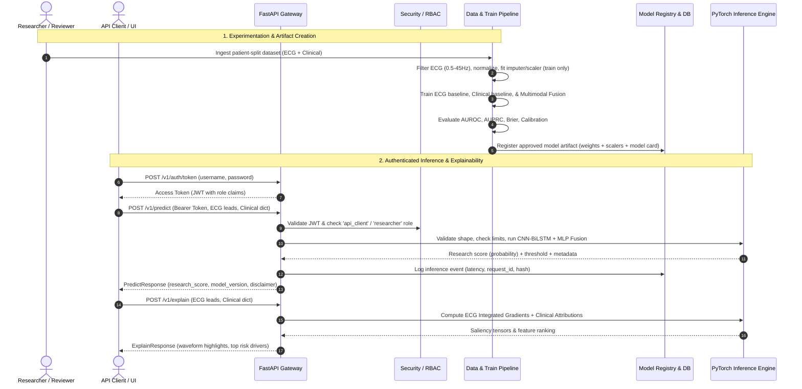

# Product Requirements Document (PRD)

## Project Title
**Multimodal Deep Learning Framework for Heart Disease Prediction Using Electrocardiogram (ECG) Signals and Structured Clinical Data**

- **Document Version:** 1.0.0
- **Status:** Approved for Implementation (Research & Educational Prototype)
- **Author:** Advanced Clinical AI Research Team
- **Date:** October 2026
- **Regulatory Status:** **Research / Investigational Use Only (RUO / IUO)**. *Not a medical device. Not cleared/approved by US FDA, CE, CDSCO, or any regulatory body. Strictly prohibited from direct clinical decision-making or autonomous patient diagnosis.*

---

## 1. Executive Summary & Vision

### 1.1 Executive Summary
Cardiovascular diseases (CVDs) remain the leading cause of morbidity and mortality globally. Conventional diagnostic and triage workflows rely on disparate data streams: static clinical risk scores (e.g., Framingham, ASCVD) capturing demographics, biometrics, and blood biomarkers, alongside electrophysiological diagnostic data (12-lead or 1-lead ECG waveforms) capturing cardiac electro-mechanics, arrhythmias, and conduction abnormalities. 

Existing predictive modeling approaches are largely siloed: unimodal clinical models overlook subtle electrophysiological morphology, while unimodal deep-learning ECG models fail to incorporate systemic factors (e.g., diabetes, age, smoking status, lipid profile).

This project designs, engineers, validates, and serves an **end-to-end reproducible Multimodal Deep Learning Framework** that combines raw/filtered multi-lead ECG time-series with structured tabular clinical data. The architecture utilizes a **Multi-scale 1D Convolutional Neural Network (CNN) coupled with a Bidirectional Long Short-Term Memory (BiLSTM) network** for ECG temporal and morphological feature extraction, an **MLP encoder with missingness-aware handling** for clinical features, and **advanced fusion mechanisms (Concatenation, Gated Fusion, and Cross-Attention)** to yield calibrated risk probabilities accompanied by multi-level explainability (ECG saliency maps and clinical feature attribution).

### 1.2 Vision Statement
To establish an open, modular, mathematically rigorous, and leakage-safe multimodal platform that accelerates translational cardiovascular ML research, enabling researchers to benchmark fusion algorithms, explain predictive drivers, and deploy secure inference microservices.

---

## 2. Regulatory, Legal & Clinical Governance Boundaries

### 2.1 Critical Disclaimers
1. **Investigational Purpose Only:** The outputs produced by this software are experimental prediction probabilities/scores and research attributions. Under no circumstances should outputs be construed as medical diagnosis, prognosis, treatment advice, or triage directives.
2. **Clinical Verification Required:** All model inferences must be reviewed and adjudicated by licensed cardiologists or medical practitioners before any research findings are considered in translational studies.
3. **Privacy & Data Governance Compliance:**
   - Adherence to HIPAA Safe Harbor de-identification (45 CFR § 164.514) and India Digital Personal Data Protection (DPDP) Act 2023.
   - Prohibits storage of Direct Identifiers (names, phone numbers, national IDs, addresses, biometric face data).
   - Enforces strict pseudonymous `record_id` and `patient_id` hashing.

---

## 3. Problem Statement & Research Objectives

### 3.1 Problem Statement
1. **Information Asymmetry:** Unimodal clinical models miss ischemic ST changes, QT prolongations, and micro-volt T-wave alternans. Unimodal ECG models miss systemic metabolic syndrome, age, and chronic hypertensive stress.
2. **Data Leakage in Medical Time-Series:** Naive train-test splits on segmented ECG heartbeats from the same patient cause severe data leakage, resulting in inflated academic metrics that catastrophically fail in real-world validation.
3. **The "Black Box" Barrier:** Deep neural networks on ECG signals lack interpretability, hindering clinician trust and validation of physiological plausibility.
4. **Deployment Fragility:** Academic code often fails to bridge the gap between notebook prototypes and production-grade, authenticated, schema-validated microservices with audit trails and fail-closed behaviors.

### 3.2 Key Research Questions & Hypotheses
- **RQ1 (Multimodal Superiority):** Does cross-modal fusion statistically significantly improve AUROC and AUPRC over both ECG-only and clinical-only baselines when evaluated on strictly patient-independent holdout splits?
- **RQ2 (Fusion Comparison):** Does adaptive cross-attention or gated fusion outperform simple vector concatenation in handling modality imbalance and noisy lead signals?
- **RQ3 (Calibration & Robustness):** Does multimodal representation maintain well-calibrated probabilities (Brier score < 0.12, low Expected Calibration Error) across varying patient age and sex subgroups?
- **RQ4 (Interpretability):** Can integrated gradients over ECG leads localize clinically known waveform segments (e.g., ST-elevation, inverted T-waves) congruent with clinical feature weights?

---

## 4. User Personas & Workflows

### 4.1 Personas
| Role | User Profile | Primary Goal | Access Level |
|---|---|---|---|
| **Researcher** | Data Scientist / Cardiologist ML Researcher | Build datasets, run training pipelines, explore fusion architectures, analyze ROC/PR curves and saliency. | Experiment execution, dataset ingestion, model inspection. |
| **Reviewer / Auditor** | Clinical Reviewer / Ethics & Compliance Officer | Validate patient-level splits, check model cards, verify calibration, approve model artifacts for staging. | Read-only experiments, audit logs, model card approval. |
| **System Administrator** | MLOps / DevOps Engineer | Maintain system uptime, manage RBAC, rotate JWT secrets, monitor inference latency and audit logs. | Full admin, user provisioning, database maintenance. |
| **API Client** | Research Application / Sandbox UI | Submit validated ECG tensors and clinical dictionaries; obtain research risk scores and explainability artifacts. | `api_client` role; `/v1/predict` and `/v1/explain`. |

### 4.2 End-to-End User Journeys


---

## 5. System & Technical Architecture

### 5.1 Technology Stack
- **Programming Language:** Python 3.12+
- **Deep Learning Framework:** PyTorch 2.3+ (CPU & CUDA compatible)
- **Scientific & Signal Processing:** NumPy 2.x, SciPy 1.14+, Pandas 2.x, Scikit-learn 1.5+
- **Web API Framework:** FastAPI 0.115+, Pydantic v2 (strict schema validation), Uvicorn (ASGI)
- **Database & ORM:** SQLAlchemy 2.0+ (SQLite for lightweight zero-dependency deployment, PostgreSQL-ready for production migrations)
- **Security & Crypto:** PyJWT, Passlib with Argon2 / bcrypt, SHA-256 integrity verification
- **Testing & Quality:** Pytest 8+, coverage reporting
- **Interactive UI:** Embedded Research Dashboard (HTML5, Vanilla CSS3 with glassmorphism dark theme, Canvas ECG rendering, vanilla ES6 JS)

### 5.2 Architectural Component Decomposition
```text
heart_disease_multimodal_framework/
├── PRD.md                             # Comprehensive Product Requirements Document
├── README.md                          # Documentation, installation, running instructions
├── requirements.txt                   # Dependency specification
├── .env.example                       # Environment configuration template
├── .env                               # Active configuration (local)
├── app.py                             # FastAPI application entry point & router mounting
├── train.py                           # CLI pipeline for training baselines & multimodal models
├── evaluate.py                        # Locked test evaluation & benchmark reporting script
├── src/
│   ├── config.py                      # Pydantic Settings application configuration
│   ├── api/
│   │   ├── routes.py                  # API endpoints (/health, /predict, /explain, /models, etc.)
│   │   ├── schemas.py                 # Request/Response Pydantic DTOs
│   │   └── dependencies.py            # FastAPI dependency injection (Auth, DB, Model Service)
│   ├── data/
│   │   ├── contracts.py               # Data models, schema contracts, validation rules
│   │   ├── ecg_processor.py           # Bandpass/notch filtering, resampling, normalization
│   │   ├── clinical_processor.py      # Missingness-aware imputer, standard scaler, encoder
│   │   ├── dataset.py                 # PyTorch MultimodalDataset, GroupShuffleSplit
│   │   └── synthetic_generator.py     # PhysioNet-realistic 12-lead ECG & clinical generator
│   ├── models/
│   │   ├── ecg_encoder.py             # Multi-Scale 1D CNN + BiLSTM + Attention/Avg Pooling
│   │   ├── clinical_encoder.py        # Missingness-aware MLP with LayerNorm & Dropout
│   │   ├── fusion.py                  # Concatenation, Gated Fusion, Cross-Attention
│   │   ├── multimodal_classifier.py   # Unified end-to-end classifier
│   │   ├── baselines.py               # Unimodal ECG-only and Clinical-only models
│   │   ├── explainability.py          # ECG Saliency / Integrated Gradients & Clinical SHAP/Permutation
│   │   ├── trainer.py                 # Training loop, early stopping, metrics calculation
│   │   └── artifact.py                # Model packaging, hashing, verification, serialization
│   ├── database/
│   │   ├── models.py                  # SQLAlchemy ORM models (Users, Experiments, Models, Audits)
│   │   ├── session.py                 # DB engine, session maker, migrations
│   │   └── service.py                 # Database repository CRUD operations
│   └── security/
│       ├── auth.py                    # Password hashing, JWT token creation/verification, RBAC
│       └── crypto.py                  # SHA-256 verification, safe hashing helpers
├── static/
│   ├── index.html                     # Research & Clinical Sandbox Dashboard
│   ├── css/style.css                  # Modern dark-mode glassmorphism stylesheet
│   └── js/app.js                      # Dynamic dashboard logic & ECG canvas rendering
├── notebooks/
│   └── multimodal_heart_disease_pipeline.ipynb # Reproducible research notebook
└── tests/
    ├── test_data_processing.py        # Unit tests for ECG filtering & clinical transformations
    ├── test_models.py                 # Unit tests for CNN, BiLSTM, Fusion heads, forward pass
    └── test_api.py                    # Integration tests for FastAPI endpoints & security
```

---

## 6. Functional Specifications

### 6.1 Data Ingestion & Preprocessing Subsystem

#### 6.1.1 ECG Processing (`src/data/ecg_processor.py`)
- **Input Specifications:**
  - Lead configuration: 1-lead (Lead II) or standard 12-lead (`I, II, III, aVR, aVL, aVF, V1, V2, V3, V4, V5, V6`).
  - Sampling rate: Configurable nominal rate (default: 500 Hz, resampled if between 100 Hz and 1000 Hz).
  - Duration/Samples: 500 to 10,000 samples per lead (default nominal window: 2,500 samples = 5 seconds at 500 Hz).
- **Processing Steps:**
  1. **Finite Value & Shape Validation:** Check that all values are finite (`not isnan`, `not isinf`). Assert shape `[leads, samples]`.
  2. **Baseline Wander Removal & Bandpass Filtering:** Butterworth bandpass filter (0.5 Hz – 45.0 Hz, 4th order, zero-phase `sosfiltfilt`) to suppress respiration drift and high-frequency muscle artifact.
  3. **Mains Notch Filter:** Optional 50 Hz / 60 Hz notch filter (Q factor = 30) for powerline interference suppression.
  4. **Resampling:** SciPy Fourier/polyphase resampling to target frequency `target_fs`.
  5. **Per-lead / Per-record Normalization:** Zero-mean, unit-variance z-score standardization or robust median-IQR scaling:
     $$x_{norm} = \frac{x - \mu}{\sigma + \epsilon}$$

#### 6.1.2 Clinical Data Processing (`src/data/clinical_processor.py`)
- **Feature Schema:**
  - Demographics & Vitals: `age` (years, 18-120), `sex` (0=female, 1=male), `resting_bp` (mmHg, 60-260), `cholesterol` (mg/dL, 80-600), `fasting_bs` (>120 mg/dL: 0 or 1), `max_hr` (bpm, 40-240), `exercise_angina` (0 or 1), `st_depression` (mm, 0.0-10.0), `st_slope` (0=upsloping, 1=flat, 2=downsloping), `num_major_vessels` (0-4).
- **Missingness & Transformation:**
  1. Add binary indicator columns (`*_is_missing`) for variables with missing rates > 0.
  2. Fit `SimpleImputer(strategy='median')` on **training data only**.
  3. Fit `StandardScaler()` on **training data only**.
  4. Store imputer and scaler states within the versioned model artifact for runtime inference.

#### 6.1.3 Patient-Level Leakage-Free Splitting (`src/data/dataset.py`)
- **Requirement:** Strict grouped splitting using `GroupShuffleSplit` on `patient_id`.
- **Constraint:** Zero overlap of patient identifiers across Train (70%), Validation (15%), and Test (15%) sets. All segments, beats, or serial records belonging to patient $P_i$ are assigned exclusively to a single split.

---

### 6.2 Model Architecture & Fusion Subsystem

#### 6.2.1 ECG Deep Feature Extractor (`src/models/ecg_encoder.py`)
- **Architecture:**
  1. **Multi-Scale Convolutional Blocks:**
     - Parallel kernel branches (Kernel sizes: 3, 7, 15) to capture localized QRS spikes, P-wave morphology, and wider T-wave intervals simultaneously.
     - 1D Convolution $\rightarrow$ BatchNorm1d $\rightarrow$ GELU/ReLU $\rightarrow$ MaxPool1d $\rightarrow$ Residual add.
     - Feature progression: `[Batch, leads, samples] -> Conv(32) -> Conv(64) -> Conv(128)`.
  2. **Recurrent Temporal Encoder:**
     - Bidirectional LSTM (`input_size=128`, `hidden_size=64`, bidirectional, yielding 128-dim features).
  3. **Temporal Attention / Global Pooling:**
     - Multi-head self-attention or adaptive average/max pooling over time frames to produce compact ECG embedding $z_{ecg} \in \mathbb{R}^{d_e}$ (default $d_e = 128$).

#### 6.2.2 Clinical Tabular Encoder (`src/models/clinical_encoder.py`)
- **Architecture:**
  - Multi-Layer Perceptron (MLP): `Linear(n_features, 64) -> LayerNorm -> ReLU -> Dropout(0.2) -> Linear(64, d_c) -> LayerNorm -> ReLU` (default $d_c = 128$).

#### 6.2.3 Cross-Modal Fusion Mechanisms (`src/models/fusion.py`)
1. **Concatenation Fusion (Baseline):**
   $$z_{fused} = [z_{ecg} \,\|\, z_{clinical}] \in \mathbb{R}^{d_e + d_c}$$
2. **Gated Multimodal Fusion:**
   Learn dynamic modality gates controlling the information flow based on signal confidence:
   $$g = \sigma(W_g [z_{ecg} \,\|\, z_{clinical}] + b_g)$$
   $$z_{fused} = [g \odot z_{ecg} \,\|\, (1 - g) \odot z_{clinical}]$$
3. **Cross-Attention Fusion:**
   Compute query from clinical embedding, keys and values from ECG temporal tokens (and vice-versa) allowing clinical risk factors to attend directly to aberrant ECG segments.

#### 6.2.4 Classifier Head
- Projection: `Linear(d_fused, 64) -> ReLU -> Dropout(0.3) -> Linear(64, 1)`.
- Loss function: `BCEWithLogitsLoss(pos_weight=w)`.
- Output: Research score $\hat{p} = \sigma(\text{logit}) \in [0, 1]$.

---

### 6.3 Explainability Subsystem (`src/models/explainability.py`)
1. **ECG Saliency / Integrated Gradients:**
   - Compute gradients of the prediction score with respect to the input ECG waveform:
     $$S(x) = \left| \frac{\partial \hat{y}}{\partial x_{lead, t}} \right|$$
   - Highlight high-attribution temporal regions (e.g., ST segment elevation, T-wave inversion) on the visual waveform canvas.
2. **Clinical Feature Attribution:**
   - Permutation feature importance and gradient-based feature attribution $\frac{\partial \hat{y}}{\partial x_{clinical}}$ indicating positive/negative risk contributors.

---

### 6.4 Model Registry & Serialization (`src/models/artifact.py`)
- **Artifact Bundle File:** `.pt` / `.tar.gz` archive containing:
  - `model_state_dict`: PyTorch weights.
  - `architecture_config`: Encoder layer sizes, leads, fusion method, embedding dimensions.
  - `clinical_schema`: List of expected feature names, types, and allowable ranges.
  - `imputer_state`: Median imputation vector.
  - `scaler_state`: Mean and scale parameters.
  - `threshold`: Optimal decision threshold tuned on the validation set for maximum F1 / balanced sensitivity-specificity.
  - `sha256`: Digest computed over weights and metadata for tamper prevention.
  - `model_card`: Markdown and JSON metadata detailing training cohort, validation AUROC/AUPRC, limitations, and ethical guidelines.

---

### 6.5 REST API Specifications (`app.py`, `src/api/`)

#### Endpoints Summary
| Method | Endpoint | Auth Required | Description |
|---|---|---|---|
| `GET` | `/health` | None | Service liveness, model loaded status, version. |
| `POST` | `/v1/auth/register` | None / Admin | Register new researcher or API client. |
| `POST` | `/v1/auth/token` | None | Obtain OAuth2 JWT Bearer Token. |
| `GET` | `/v1/model` | None | Retrieve active model metadata, model card, and disclaimer. |
| `POST` | `/v1/model/load` | Admin/Researcher | Dynamically load or swap an approved model artifact. |
| `POST` | `/v1/predict` | `api_client`, `researcher`, `admin` | Generate multimodal risk prediction. |
| `POST` | `/v1/explain` | `researcher`, `admin` | Compute ECG saliency map and clinical attributions. |
| `GET` | `/v1/experiments` | `researcher`, `admin` | Retrieve experiment history, hyperparameters, and metrics. |
| `GET` | `/v1/audit` | `admin` | Query anonymized audit and inference telemetry logs. |

---

## 7. Non-Functional Requirements (NFR)

1. **Deterministic Reproducibility:**
   - Set fixed seeds (`torch.manual_seed(42)`, `np.random.seed(42)`).
   - Log exact commit hash, dependency versions, and dataset manifest SHA-256.
2. **Performance & Latency:**
   - API inference response time $\le 150 \text{ ms}$ on CPU for a 5-second 12-lead ECG (2,500 samples) and 10 clinical features.
   - Batch evaluation throughput $\ge 200 \text{ records/second}$ on standard GPU / multi-core CPU.
3. **Security, Privacy & RBAC:**
   - All passwords hashed via Argon2 / bcrypt.
   - Access tokens use signed JWT (HMAC-SHA256) with 30-minute expiration.
   - Principle of Least Privilege: Role enforcement on every mutating route.
   - Zero retention of raw health data in debug logs; sanitized request ID tracking.
4. **Code Quality & Testing:**
   - 100% type annotations with strict Pydantic v2 schemas.
   - Comprehensive test suite covering data filtering, model forward passes, authentication, prediction errors, and artifact loading.

---

## 8. Data Contract Specifications

### 8.1 Inference Request Schema (`PredictRequest`)
```json
{
  "record_id": "REC_98472",
  "sampling_rate_hz": 500.0,
  "ecg": [
    [0.012, 0.015, -0.003, "... 2500 samples for Lead I ..."],
    [0.022, 0.035, -0.010, "... 2500 samples for Lead II ..."],
    ["... up to 12 leads ..."]
  ],
  "clinical": {
    "age": 62.0,
    "sex": 1.0,
    "resting_bp": 142.0,
    "cholesterol": 245.0,
    "fasting_bs": 1.0,
    "max_hr": 138.0,
    "exercise_angina": 1.0,
    "st_depression": 2.4,
    "st_slope": 1.0,
    "num_major_vessels": 2.0
  }
}
```

### 8.2 Inference Response Schema (`PredictResponse`)
```json
{
  "request_id": "9b1deb4d-3b7d-4bad-9bdd-2b0d7b3dcb6d",
  "model_version": "v1.0.0-multimodal-gated",
  "research_score": 0.7842,
  "decision_threshold": 0.50,
  "prediction_label": "High Risk Indication (Experimental)",
  "modality_contributions": {
    "ecg_weight": 0.62,
    "clinical_weight": 0.38
  },
  "latency_ms": 28,
  "disclaimer": "Research prototype only. Outputs are experimental model scores, not medical diagnoses or clinical advice."
}
```

---

## 9. Verification & Acceptance Criteria

- [x] **PRD & Architecture Specification:** Detailed requirements, threat models, mathematical formulations, and UI/API designs.
- [ ] **Data Subsystem:**
  - Robust Butterworth filtering (0.5-45 Hz), notch filter, normalization.
  - Train-only clinical imputation and standard scaling.
  - Patient-grouped leakage-free splitting with zero patient overlap.
- [ ] **Deep Learning Models:**
  - Multi-scale 1D CNN + BiLSTM ECG encoder.
  - Missingness-aware MLP clinical encoder.
  - Multi-modal fusion (Concatenation, Gated, Cross-Attention).
  - Unimodal baseline trainers (ECG-only, Clinical-only) for ablation benchmarking.
- [ ] **Explainability:**
  - Gradient-based ECG saliency vector extraction.
  - Clinical feature importance rankings.
- [ ] **Security, Database & API:**
  - Full FastAPI microservice with JWT auth, RBAC, input validation, audit logging, model loading.
  - Database persistence for users, experiments, model versions, and audit logs.
- [ ] **Modern Web Application / Dashboard:**
  - Interactive web UI with real-time ECG waveform canvas, clinical input controls, model benchmark comparisons, and live prediction sandbox.
- [ ] **Automated Tests & Quality:**
  - Passing pytest suite covering data processing, neural network components, and API endpoints.

---
*End of PRD.*
